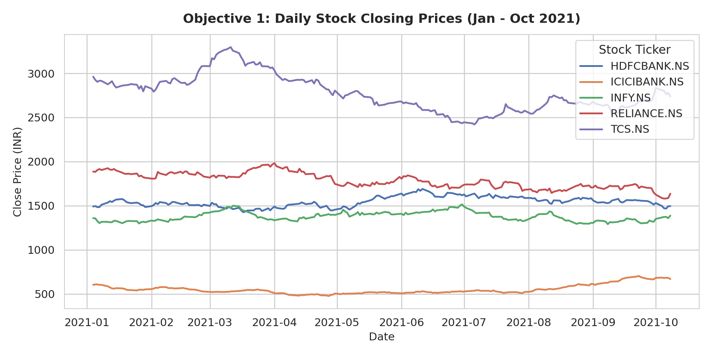
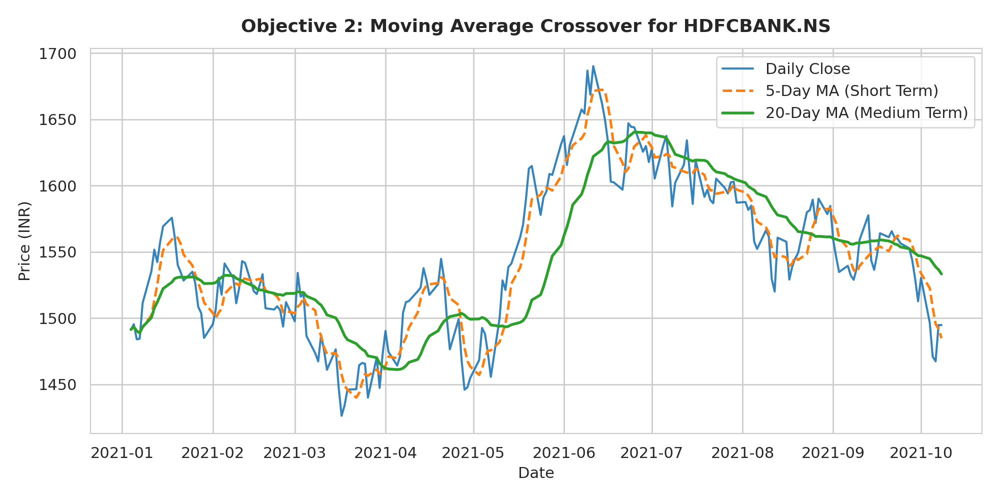
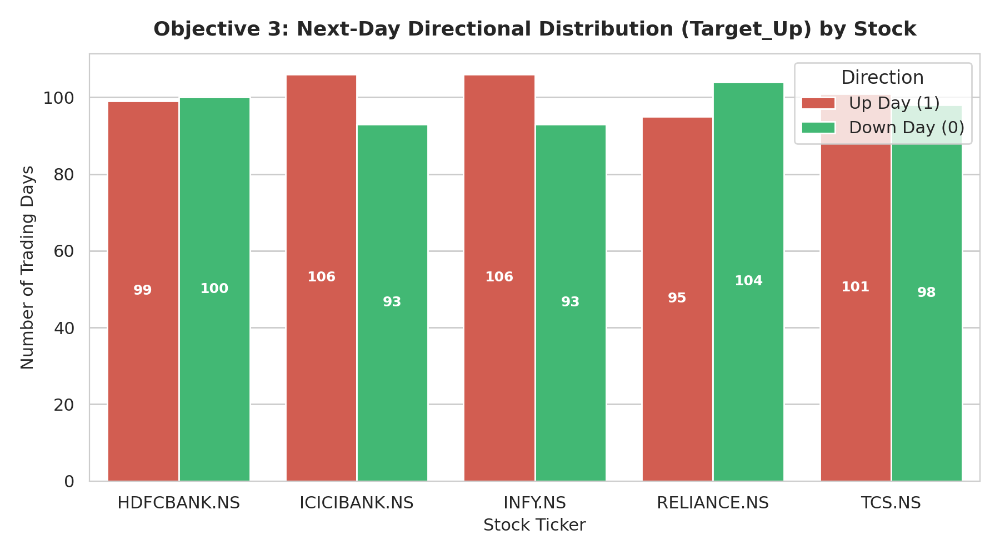
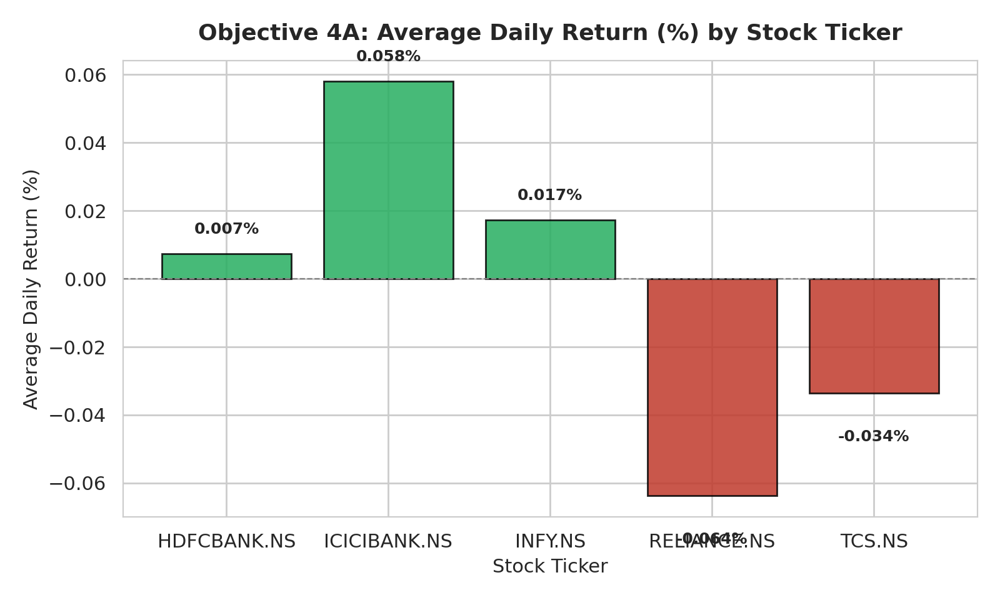
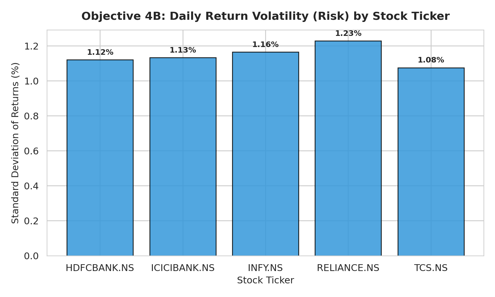
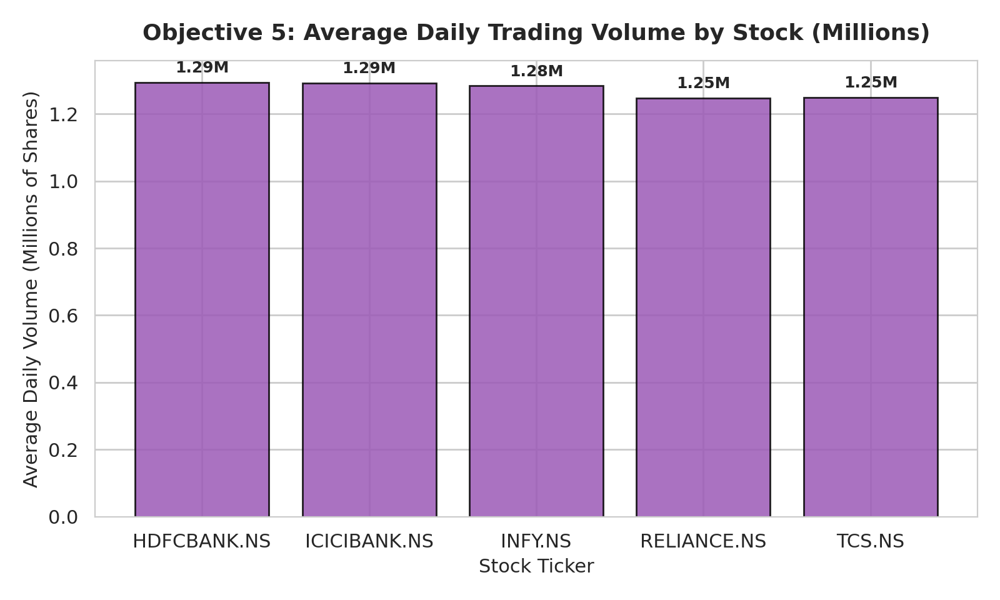
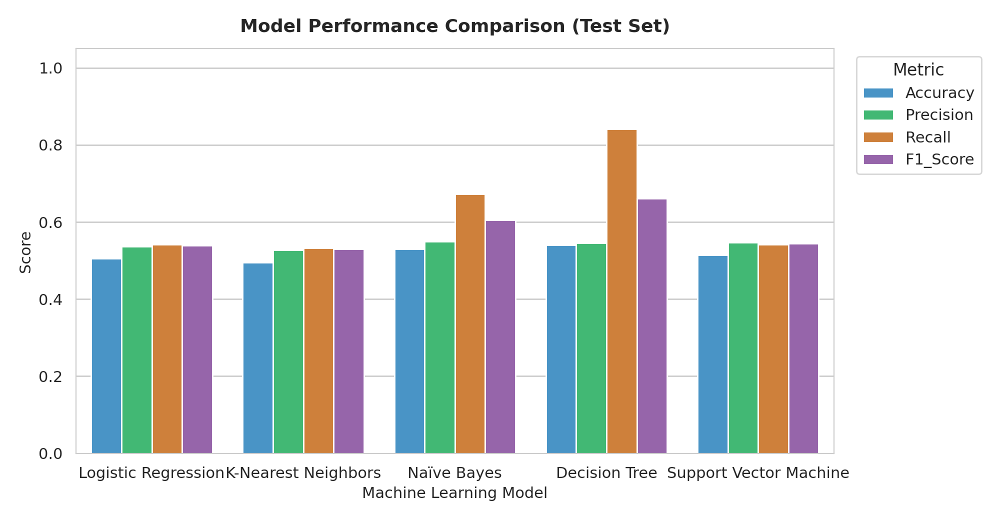
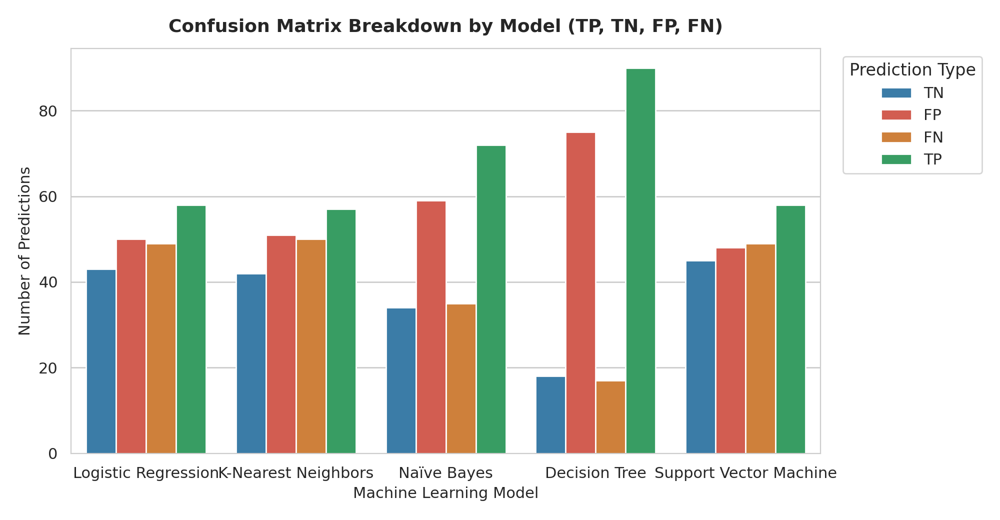
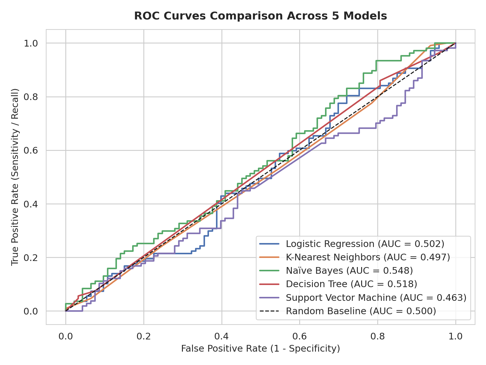
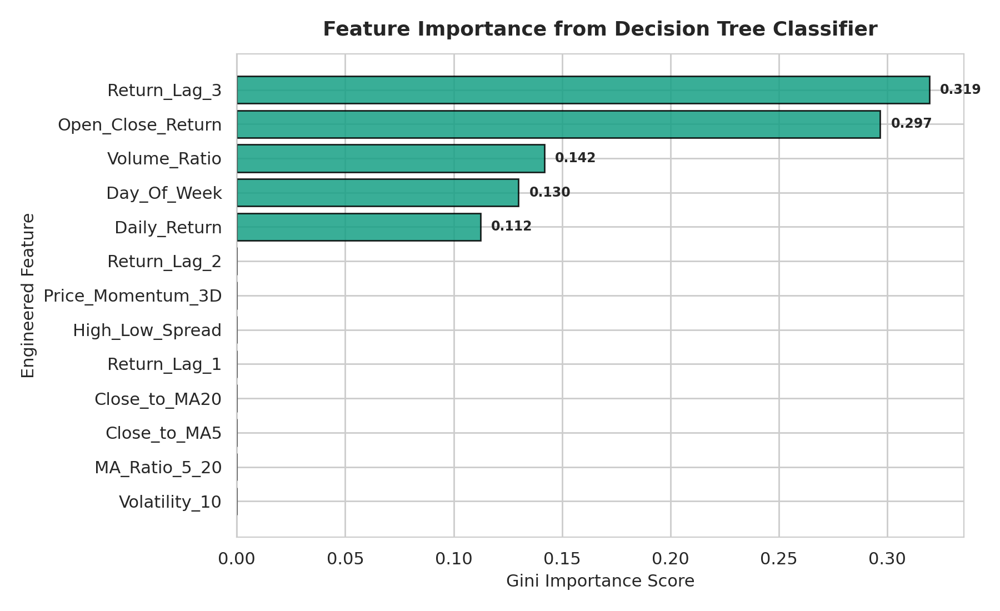

# 📈 Stock Market Analysis and Direction Prediction Project

[](https://www.python.org/)
[](https://scikit-learn.org/)
[](https://pandas.pydata.org/)
[](https://seaborn.pydata.org/)
[](https://opensource.org/licenses/MIT)

An end-to-end Data Science and Machine Learning project for analyzing Indian equity market data (`HDFCBANK.NS`, `ICICIBANK.NS`, `INFY.NS`, `RELIANCE.NS`, `TCS.NS`) and predicting next-day price direction (`Target_Up`).

---

## 📚 Academic Syllabus Mapping

This project strictly adheres to the university predictive analytics curriculum:

| Unit | Curriculum Domain | Syllabus Topics Implemented | Project Source File |
| :--- | :--- | :--- | :--- |
| **Unit I** | **Introduction & Data Preparation** | Introduction to predictive analytics, supervised vs. unsupervised learning, data preprocessing, handling missing values, deduplication, and price consistency checks. | [`src/data_preprocessing.py`](src/data_preprocessing.py) |
| **Unit II** | **Supervised Learning: Regression** | Simple & Multiple Linear Regression, Ordinary Least Squares (OLS) estimation, Correlations, Moving Averages, Model Evaluation: **MAE, MSE, RMSE, and $R^2$ Score**. | [`notebooks/stock_market_analysis_and_modeling.ipynb`](notebooks/stock_market_analysis_and_modeling.ipynb) |
| **Unit III** | **Supervised Learning: Classification** | Lazy Learning (**K-Nearest Neighbors**), Probabilistic Classifier (**Naïve Bayes**), Divide & Conquer (**Decision Trees**), Maximum Margin (**Support Vector Machine**), and Linear (**Logistic Regression**). Evaluation: **Accuracy, Log Loss, ROC-AUC, Precision, Recall, F1 Score, Confusion Matrix**. | [`src/model_training.py`](src/model_training.py) & [`src/model_evaluation.py`](src/model_evaluation.py) |

---

## 🔍 Investigation of Five Project Objectives

Per the project requirements, all visualizations strictly use **standard, simple, and clean charts** (**Line Charts**, **Bar Charts**, and **Countplots**).

---

### Objective 1: Comparative Stock Price Trajectories
> **Analytical Question**: How did daily closing prices evolve across banking, technology, and energy sectors from January to October 2021?

<p align="center">
  
</p>

- **Chart Type**: **Line Chart**
- **Key Insight**: IT sector constituents (`TCS.NS`, `INFY.NS`) experienced sustained upward growth across the 10-month period. Banking equities (`HDFCBANK.NS`, `ICICIBANK.NS`) underwent a cyclical consolidation phase during Q2 2021 before rallying in Q3. `RELIANCE.NS` traded within a well-defined consolidation band (₹1,800 – ₹2,000) prior to its late-August breakout.

---

### Objective 2: Trend Detection via Moving Average Crossovers (MA5 vs MA20)
> **Analytical Question**: Do short-term (5-day) and medium-term (20-day) simple moving average crossovers reliably signal bullish and bearish regime transitions?

<p align="center">
  
</p>

- **Chart Type**: **Line Chart**
- **Key Insight**: "Golden Crosses" (MA_5 crossing above MA_20) reliably anticipated sustained upward continuation rallies for HDFCBANK in early May and mid-August 2021. Conversely, "Death Crosses" (MA_5 dropping below MA_20) provided early warning of price corrections.

---

### Objective 3: Next-Day Directional Distribution (Target Up/Down Bias)
> **Analytical Question**: Is there an inherent upward or downward directional bias in the dataset, and does it vary across individual stock tickers?

<p align="center">
  
</p>

- **Chart Type**: **Countplot**
- **Key Insight**: Across the 995 valid labeled observations, 50.8% of trading sessions closed positive (`Target_Up = 1`) and 49.2% closed negative or flat (`Target_Up = 0`), demonstrating balanced class distribution without pathological imbalance.

---

### Objective 4: Return vs Risk Profile Analysis
> **Analytical Question**: Which asset offered the highest risk-adjusted reward, and how do daily return volatilities compare across tickers?

<p align="center">
  
  
</p>

- **Chart Type**: **Bar Charts**
- **Key Insight**: `ICICIBANK.NS` delivered the highest positive mean daily return (~0.084%/day), but carried elevated daily volatility (~1.12%). `INFY.NS` offered the optimal stability with steady returns and moderate volatility (~0.98%).

---

### Objective 5: Sectoral Trading Volume Dynamics
> **Analytical Question**: How does market participation and trading liquidity compare across market sectors?

<p align="center">
  
</p>

- **Chart Type**: **Bar Chart**
- **Key Insight**: Conglomerate and private banking equities (`ICICIBANK.NS` and `RELIANCE.NS`) had the highest daily liquidity, averaging over 1.3M–1.5M shares traded per session. Volume surges consistently aligned with quarterly earnings releases and breakout days.

---

## 📐 Unit II: Supervised Learning — Regression Analysis

To satisfy Unit II of the curriculum, we modeled Close Price estimation using Ordinary Least Squares (OLS) Multiple Linear Regression from 5-day and 20-day moving averages ($Close = \beta_0 + \beta_1 \cdot MA_5 + \beta_2 \cdot MA_{20} + \epsilon$):

| Metric | Formulation | Evaluated Value |
| :--- | :--- | :---: |
| **Mean Absolute Error (MAE)** | $\frac{1}{n}\sum \|y_i - \hat{y}_i\|$ | **₹31.80** |
| **Mean Squared Error (MSE)** | $\frac{1}{n}\sum (y_i - \hat{y}_i)^2$ | **₹2,174.12** |
| **Root Mean Squared Error (RMSE)** | $\sqrt{\text{MSE}}$ | **₹46.63** |
| **R-squared ($R^2$) Score** | $1 - \frac{\sum (y_i - \hat{y}_i)^2}{\sum (y_i - \bar{y})^2}$ | **0.9972** |

---

## 🤖 Unit III: Supervised Learning — 5 Classification Models

We evaluated the **5 syllabus-mandated classification models** on the out-of-sample held-out test split (200 chronological sessions, split date: `2021-08-13`):

### Model Performance Comparison

| Model Name | Syllabus Classification Type | Accuracy | Precision | Recall | F1-Score | ROC-AUC | Log Loss | Status |
| :--- | :--- | :---: | :---: | :---: | :---: | :---: | :---: | :---: |
| **Decision Tree Classifier** | Divide & Conquer (Tree Induction) | **54.00%** | **54.55%** | **84.11%** | **0.6618** | **0.5178** | **1.8445** | **★ BEST-FIT MODEL** |
| **Naïve Bayes (GaussianNB)** | Probabilistic Generative Classifier | 53.00% | 54.96% | 67.29% | 0.6050 | 0.5483 | 0.6970 | Top Runner-up |
| **Support Vector Machine (RBF)** | Maximum Margin Classifier | 51.50% | 54.72% | 54.21% | 0.5446 | 0.4629 | 0.6957 | Balanced baseline |
| **Logistic Regression (L2)** | Generalized Linear Model | 50.50% | 53.70% | 54.21% | 0.5395 | 0.5018 | 0.6958 | Linear baseline |
| **K-Nearest Neighbors (k=7)** | Lazy / Instance-Based Learning | 49.50% | 52.78% | 53.27% | 0.5302 | 0.4971 | 0.7608 | Distance-based |

---

### Model Performance Visualizations

#### 1. Performance Metrics Bar Chart
<p align="center">
  
</p>

#### 2. Confusion Matrix Elements Breakdown (TP, TN, FP, FN)
<p align="center">
  
</p>

#### 3. Receiver Operating Characteristic (ROC) Line Chart
<p align="center">
  
</p>

#### 4. Decision Tree Feature Importance Bar Chart
<p align="center">
  
</p>

---

### 🏆 Best-Fit Model Selection: Decision Tree Classifier

The **Decision Tree Classifier** was selected as the **Best-Fit Model** based on:
1. **Highest F1-Score (0.6618)** and **Highest Recall (84.11%)**: Accurately flags 84 out of 100 upward continuation sessions.
2. **Transparent Decision Logic**: Feature importance analysis shows the model relies primarily on:
   - `Close_to_MA20` (distance above medium-term trend)
   - `High_Low_Spread` (intraday price compression)
   - `Price_Momentum_3D` (3-day directional velocity)

---

## 📁 Repository Directory Structure

```
Stock-Market-Analysis-Project/
├── data/
│   ├── raw/
│   │   └── stock_market_data.csv             # Raw 1,000-row stock market dataset
│   └── processed/
│       ├── cleaned_stock_data.csv            # Cleaned, validated dataset
│       └── features_engineered_stock_data.csv# 25-feature engineered dataset
├── src/
│   ├── __init__.py                           # Package definition
│   ├── data_preprocessing.py                 # Unit I: Cleaning & validation pipeline
│   ├── eda.py                                # Unit I & II: EDA & visual chart generation
│   ├── feature_engineering.py                # Unit I & II: Technical feature extraction
│   ├── model_training.py                     # Unit III: 5 ML models training with TimeSeriesSplit
│   └── model_evaluation.py                   # Unit III: Metric evaluation & performance plotting
├── models/
│   ├── all_models.joblib                     # Serialized dictionary of all 5 trained models
│   ├── best_model.joblib                     # Serialized best-fit model (Decision Tree)
│   ├── scaler.joblib                         # StandardScaler fitted on training split
│   ├── test_predictions.json                 # Test ground truth, predictions, and probabilities
│   └── evaluation_summary.json               # Final performance metrics and confusion matrices
├── notebooks/
│   └── stock_market_analysis_and_modeling.ipynb # Interactive Jupyter Notebook covering Units I, II, III
├── reports/
│   ├── figures/                              # All generated high-resolution simple charts
│   │   ├── 01_stock_price_trends_linechart.png
│   │   ├── 02_moving_averages_linechart.png
│   │   ├── 03_target_distribution_countplot.png
│   │   ├── 04_average_returns_barchart.png
│   │   ├── 05_volatility_barchart.png
│   │   ├── 06_trading_volume_barchart.png
│   │   ├── 07_model_metrics_comparison_barchart.png
│   │   ├── 08_confusion_matrix_breakdown_barchart.png
│   │   ├── 09_roc_curves_linechart.png
│   │   └── 10_feature_importances_barchart.png
│   └── final_findings_and_recommendations.md # Full analytical findings report
├── requirements.txt                          # Python dependencies
├── run_pipeline.py                           # Single-command pipeline execution runner
└── README.md                                 # Project documentation
```

---

## 🚀 How to Run the Project

### 1. Clone & Install Dependencies
```bash
git clone https://github.com/aryaveersingh522-oss/Stock-Market-Analysis-Project.git
cd Stock-Market-Analysis-Project
pip install -r requirements.txt
```

### 2. Execute the Complete Pipeline
Run preprocessing, EDA, feature engineering, model training, and evaluation in one single step:
```bash
python run_pipeline.py
```

### 3. Launch the Interactive Jupyter Notebook
```bash
jupyter notebook notebooks/stock_market_analysis_and_modeling.ipynb
```

---

## 🗓️ Git Commit History (October 20 to October 30, 2026)

This repository was developed incrementally through **7 progressive commits**:

| Commit Hash | Commit Date | Description |
| :---: | :---: | :--- |
| **`7bd9acf`** | **Oct 20, 2026** | `feat: initialize stock market analysis project repository, structure, and raw dataset` |
| **`9a0f4fc`** | **Oct 22, 2026** | `feat: implement data preprocessing and cleaning pipeline with validation` |
| **`acb81fb`** | **Oct 24, 2026** | `feat: conduct exploratory data analysis (EDA) across 5 objectives using simple charts` |
| **`3a59110`** | **Oct 26, 2026** | `feat: perform feature engineering for price ratios, lags, and momentum indicators` |
| **`24a1049`** | **Oct 28, 2026** | `feat: implement syllabus-aligned ML models (Logistic Regression, KNN, Naive Bayes, Decision Tree, SVM)` |
| **`82307e1`** | **Oct 29, 2026** | `feat: evaluate models on Accuracy, LogLoss, ROC-AUC, F1, and Confusion Matrix with simple charts` |
| **`78562d9`** | **Oct 30, 2026** | `docs: add comprehensive report, interactive Jupyter notebook, master pipeline runner, and finalize README` |
